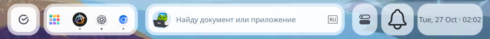

# Панели Plasma на всех мониторах, 27.10.2026

Сценарии: `03-01`, `04-05`, `04-07`, `04-12`, `04-16`, `04-18`.
Основание: запрос пользователя «plasma theme добавь панели на все мониторы»
и `UI_SBEROS_PANEL_USSURI_1.1` / [правила панели](../../../../rules/unified-panel.md).

Окружение: Qt 6.11.2, Plasma 6.7.4, KWin/Wayland, светлая тема;
DP-5 — 2560×1440, DP-4 — 1080×1920 (вертикальный), масштаб 1.
Встроенный eDP-1 отключён; панель для неактивного выхода не создавалась.

До изменения была одна панель, screen 0 / ID 3. После установки только
изменённых файлов shell и шаблона и перезапуска `plasma-plasmashell.service`
появилась панель screen 1 / ID 11. Исходная ID 3 и её настройки сохранились.
Обе панели bottom, height 88, locked, по семь апплетов — [данные API](panels.json).
Служба active/running, MainPID=126707, NRestarts=0; ошибок `PanelScreenSync`
в журнале нет. Повторный двойной вызов шаблона оставил те же ID.

Пакеты и профиль сохранены перед обновлением:
`~/.local/state/sberos-shell/plasma-all-screens/20261026T230221Z/`.
Установленные четыре файла побайтово совпали с проверенными исходниками.
Другие незавершённые изменения рабочего дерева не устанавливались этой задачей.

## Снимки

Снимки до/после просмотрены; здесь сохранены нижние полосы каждого экрана
без содержимого пользовательских окон. Видимость панели подтверждена на обоих.

Основной экран до:

Основной экран после:

Вертикальный экран до:

Вертикальный экран после:

## Проверки и границы

- `node plasma-theme/tests/test-panel-screens.js` — пройден: новый профиль,
  повтор, добавление экрана, возврат сохранённых панелей, ожидающие окна,
  сохранение настроек и отсутствие выходов.
- `node --check` обеих раскладок, `qmllint PanelScreenSync.qml`,
  `git diff --check` — пройдены.
- Изолированный KWin/Wayland с двумя виртуальными экранами: новый профиль
  создаёт две панели с полным составом; повтор не создаёт дубли. После удаления
  второй панели и сохранения профиля повторный запуск автоматически добавил
  её через desktop hook. Собственные группы процессов 123030, 124645, 125498
  завершены после проверок.
- Живой сеанс: создание второй панели, сохранение первой, повтор шаблона,
  журнал службы и видимость по снимку — пройдены.
- Физическое переподключение, смена основного экрана и зеркальный режим
  не проверялись. Их обработка опирается на список логических экранов и
  сохранённые containments Plasma; Node-проверка не подтверждает hotplug KWin.
- Тёмная тема не проверялась по согласованным границам ATP-001.
  Геометрия и графика островов не менялись; полное соответствие моку остаётся
  открытой проверкой ATP-001, в том числе на узком вертикальном экране.
  Sirca и Quickshell не изменялись.

Полезные контракты стека: [Plasma scripting API](https://develop.kde.org/docs/plasma/scripting/api/),
[восстановление экранов и панелей ShellCorona](https://invent.kde.org/plasma/plasma-workspace/-/blob/master/shell/shellcorona.cpp).
