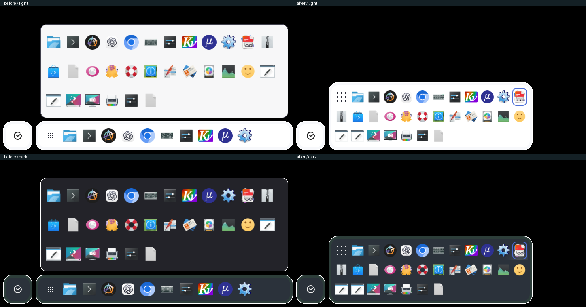

# PANEL-003: раскрытие острова Sirca, 27.10.2026

Проверены части FT_SMART_PANEL_APPLICATIONS_11–14 / UI_9–12,
UI_6–7 (меню и перестановка), сценариев 02-04–02-08, 03-14–03-18, 03-22.
Это проверка конкретной доработки, а не приёмка всех сценариев PANEL-003.

До: снимок исходного `Dock.qml` из состояния репозитория `78139b9`, отдельная
плашка над строкой. После: изменения коммита
`shell: раскрывай остров приложений в сетку` (найти: `git log -- shell/shell/qml/ApplicationsIsland.qml`).
Референс мока — `78139b9:docs/mock/smart-panel/`, expanded grid 12×40 / 48 px.

## Среда и воспроизведение

Qt 6.11.2, KWin/Plasma 6.7.4, Linux, виртуальный Wayland 1920×1080, DPR 1,
мышь/клавиатура, темы Sirca light и dark. Параметры: dockVisibility=always,
dockDodge=false, dockFullscreenMode=keep. Каждому запуску выделены частные D-Bus,
KWin, XDG config/data/cache/state; 30 закреплений из установленных desktop entries.
Иконки приложений системные; несколько desktop entries не имеют доступной иконки.
Обои отключены, прозрачные части grabToImage выглядят чёрными в просмотрщике.
Настройки пользователя, его основной сервис и установленный бинарник не менялись.

Из корня репозитория:

```sh
cmake --build shell/shell/build -j4
python3 shell/shell/tests/run-applications-island.py --output /tmp/island-offscreen
python3 shell/shell/tests/run-applications-island.py --wayland --output /tmp/island-wayland
python3 shell/shell/tests/run-applications-island.py --baseline --wayland --binary /path/to/previous/sirca-shell --output /tmp/island-before
/usr/lib/qt6/bin/qmllint -I ui-kit/_build/qml -I shell/shell/build shell/shell/qml/ApplicationsIsland.qml shell/shell/qml/Dock.qml shell/shell/qml/Surface.qml shell/shell/qml/UnifiedPanel.qml shell/shell/qml/Main.qml
python3 ui-kit/tools/api_contract.py --check
```

Каталоги вывода должны быть новыми. KWin/D-Bus требуют доступа к локальным сокетам.
Runner ограничен 35 секундами и завершает только собственную группу процессов.
Все процессы прогонов остановлены. `offscreen.log` содержит только записи проверки;
полные Wayland-журналы сохранены в `before/` и `after/`.

## Результат

Сборка — прошла, [журнал](build.log). `qmllint` — exit 0,
[предупреждения динамических типов Main/UnifiedPanel](qmllint.log) сохранены;
ApplicationsIsland/Dock/Surface не выдают предупреждений. Контракт UI Kit актуален;
реализация библиотеки не менялась. В API добавлено пояснение отступов Button.
При регистрации нового QML-компонента `qt_standard_project_setup` перенесён сразу
после поиска Qt; избыточный ручной AUTOMOC удалён.

| Проверка | Результат |
| --- | --- |
| Те же Launchpad и делегаты до/после раскрытия | Объекты не пересоздаются при перестроении сетки |
| Сетка, +N, неполная последняя строка | 31 элемент, 12 столбцов, значки 32 px, +20 скрыт в сетке |
| Геометрия острова | 636×72 → 504×168, левый край 88, низ 1072 в обоих состояниях |
| Окно панели и резерв | Тот же native ID, 1920×764, (0,316), резерв 88 px |
| Развёрнутый / полноэкранный клиент | 1920×992 / 1920×1080 во всех снятых состояниях |
| Соседние острова | Сбер, Оська и системная зона не перемещаются |
| Клавиатура и дочернее меню | Стрелки, Tab/Shift+Tab с переходом через край, Shift+F10, два Escape, возврат на +N |
| Ограничение высоты / прокрутка | При тестовом лимите 120 px фокус последнего элемента прокручивает viewport |
| DnD с настоящим TaskManager | Перенос в следующую строку; порядок записан в Config.launchers |
| Изменение модели / глобальное закрытие | Без переполнения сетка закрывается; Main.closePopups также её закрывает |

[Геометрия до](before/geometry.json), [после с измерениями клиентов и KWin](after/geometry.json),
[Wayland-журнал](after/run.log), [подставная модель offscreen](offscreen.log).
Снимки — содержимое реального окна панели через grabToImage; нативные координаты
проверены отдельно скриптом KWin. Чёрный фон снимка не является полноэкранным окном Sirca.

## Визуальное сравнение

Слева до, справа после; светлая и тёмная темы. Кропы для сравнения, полные снимки ниже.



| Состояние | До | После |
| --- | --- | --- |
| Светлая, строка | [PNG](before/light-closed.png) | [PNG](after/light-closed.png) |
| Светлая, раскрыто | [PNG](before/light-open.png) | [PNG](after/light-open.png) |
| Тёмная, раскрыто | [PNG](before/dark-open.png) | [PNG](after/dark-open.png) |
| Тёмная, строка | [PNG](before/dark-closed.png) | [PNG](after/dark-closed.png) |
| Меню поверх сетки | — | [PNG](after/context-menu.png) |
| Прокрутка при ограничении высоты | — | [PNG](after/scrolled.png) |

Sirca: частичное соответствие моку — сетка 12×40 / 48, отступы и радиусы поверхности.
Остаются конкретные расхождения: начало острова x=88 против x=96 HTML;
компактные размеры следуют Config и коэффициенту 0.8, нет разделителя групп,
отличается графика Launchpad и индикаторов. Blur и прозрачность на содержательном
фоне этим grabToImage не подтверждены. Quickshell не изменялся и не проверялся.

Открыты ручные клики за границами окна и возврат нативного фокуса с дочернего
меню, предпросмотр реальных групп/активация/закрытие окон, перенос файлов,
ширины 1280/1440, физические мониторы, hotplug, смешанный масштаб. Подставная
модель offscreen не подтверждает системные интеграции. Три замечания пользователя
о поиске, меню Сбера и календаре записаны в PANEL-003 и здесь не объявляются исправленными.
